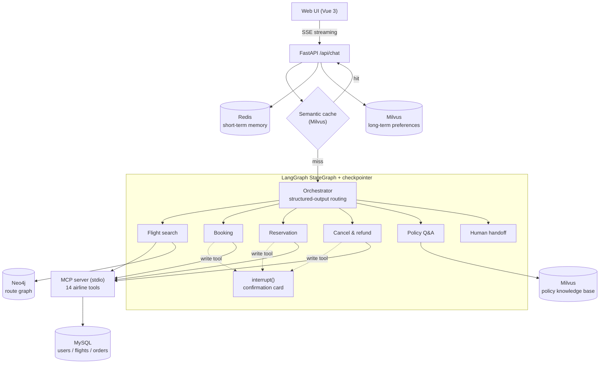

<p align="center">
  
</p>

<h1 align="center">WingDesk · 翼枢</h1>

<p align="center">
  <strong>Multi-Agent Airline Customer Service</strong><br />
  From finding a flight to changing a reservation, every step stays in your hands.
</p>

<p align="center">
  
  
  
  
</p>

<p align="center"><strong>English</strong> · <a href="README.zh-CN.md">简体中文</a></p>

WingDesk is a multi-agent customer service system for an airline. Users can search flights, book tickets, change or cancel reservations, ask about baggage and refund policies, and request compensation, all in natural language.

The hard part of airline customer service is not chatting. The agent has to **actually get things done**, every action is constrained by detailed policies, and **mistakes are not acceptable**. The guiding principle of this project:

> **Anything that can be guaranteed by code is not left to the model.**

- Write operations need user confirmation → enforced with LangGraph `interrupt`, not a prompt instruction
- Routing must be valid → structured output with an enum, not string parsing
- Users must not access others' data → `user_id` is injected by code, never trusted from the model
- Key business rules must hold → validated in code before every write, not only written in the prompt

<!-- Demo GIF: record one and save it as docs/demo.gif, then uncomment the line below.

-->

## Architecture



| Layer | Tech | Role |
|---|---|---|
| Agent | LangGraph, LangChain | Orchestrator + 5 specialist ReAct agents + human handoff; checkpointer for multi-turn state and interrupt/resume |
| Tools | MCP (FastMCP, `langchain-mcp-adapters`) | 14 airline tools as a standalone server; one long-lived session shared by the whole app |
| Business data | MySQL 8 | 10 tables; every write runs in a transaction with row locks (`SELECT … FOR UPDATE`) |
| Route graph | Neo4j | Airports and flights as a graph; parameterized Cypher for 1–3 leg routes |
| Vector store | Milvus 2.5 | Policy RAG, semantic cache, long-term user preferences |
| Short-term memory | Redis | Recent turns stored as a List, written atomically |
| LLM | Qwen (`qwen-plus`), `text-embedding-v2` | Called through an OpenAI-compatible API, so switching models only needs config |
| API / UI | FastAPI, SSE, Vue 3 + TypeScript + Vite | Real token streaming, live routing trace, confirmation cards; model output sanitized with DOMPurify before rendering |

### Agents and least privilege

| Agent | Responsibility | Tools |
|---|---|---|
| Orchestrator | Classify intent and route (sticky: a task in progress stays with its agent) | none |
| Flight search | Airports, direct and one-stop flights, routes | read-only |
| Booking | New bookings | search, user details, `calculate`, `book_reservation` |
| Reservation | View orders; change flights, cabin, baggage, passengers | read + `update_reservation_*` |
| Cancel & refund | Cancellations and compensation | read + `cancel_reservation`, `send_certificate` |
| Policy Q&A | Policy questions via RAG | Milvus retrieval |
| Human handoff | Transfer to a human agent | `transfer_to_human_agents` |

Each specialist only gets the tools and the policy sections it needs. A read-only agent physically cannot call a write tool.

## Key design decisions

### 1. Human-in-the-loop confirmation with `interrupt`

Prompt-only rules ("ask the user before booking") are probabilistic. In testing, the model sometimes kept asking for confirmation in chat instead of calling the tool. So every write tool is wrapped: before it runs, it calls LangGraph `interrupt()`. The whole graph is suspended and its state saved in the checkpointer. The UI shows a confirmation card, and the user's answer resumes the graph with `Command(resume=...)`.

- The summary on the card is **generated by code from the real tool arguments**, not written by the model, so what the user confirms is exactly what will run.
- If the user types a reply instead of clicking, it is treated as feedback: the agent revises the plan and shows a new card.
- `thread_id = user_id:session_id`. Using only `session_id` let different users share the default session.

### 2. MCP: one long-lived session instead of a subprocess per call

Each tool call took over 300 ms while the database query itself took a few ms. Reading the `langchain-mcp-adapters` source showed that tools loaded with `client.get_tools()` are stateless: **every call opens a new session, and for stdio that means spawning a new subprocess** and redoing the handshake. WingDesk opens one session in the FastAPI `lifespan` hook and shares it across the app.

| | Mean | Median | P95 |
|---|---|---|---|
| Session per call | 342.0 ms | 320.4 ms | 502.6 ms |
| Shared long-lived session | 3.9 ms | 3.5 ms | 9.4 ms |

<sub>20 calls of `search_direct_flight`, `agent/tests/bench_mcp_session.py`.</sub>

A long-lived connection needs to heal itself. Each server's connection is owned by a supervisor task (the stdio client uses anyio task groups, so a connection must be opened and closed in the same task), and tools hold a session proxy instead of the session itself, so a reconnect needs no rebuild of the agent graph:

- **Detection**: a ping every 30 s with a 5 s timeout catches a hung server; a closed connection during a call (`CONNECTION_CLOSED`, broken pipe, 30 s call timeout) triggers a reconnect with exponential backoff.
- **Retry policy**: read-only tools are retried once on the new connection. Write tools are not retried, because the request may already have succeeded on the old connection; the model is told the result is unknown and should check the reservation first.
- **Visibility**: `GET /api/health` returns 200 or 503 with connection state, reconnect count and ping latency. Tests kill the MCP server process with `SIGKILL` and check that both paths recover.

### 3. Semantic cache with a measured threshold

Frequent policy questions are answered from a cache and skip the full agent run. A subtle pitfall found during development: with COSINE, Milvus returns a **similarity**, not a **distance**. Comparing it like a distance (`<=` instead of `>=`) means semantic hits never happen. With that fixed, the threshold was chosen by experiment instead of by guess:

- Test set: 57 queries — 30 paraphrases, 17 hard negatives (look similar but need a different answer, e.g. "why hasn't *my* refund arrived"), 10 easy negatives.
- Compared three embedding models (`text-embedding-v2/v3/v4`); thresholds do not transfer between models.
- Improvements: store several phrasings per answer, and a rule pre-filter that sends personal questions (my order, booking codes…) straight to the agent.

| Setup (`text-embedding-v2`) | Recall at zero false hits |
|---|---|
| Threshold only | 33% |
| + multiple phrasings + rule pre-filter | **90%** (threshold 0.66) |

When a cached answer is served, the turn is also written back into the checkpointer, so the agent still knows what was asked.

### More engineering details

- **Business rules in code.** Payment limits (e.g. at most one travel certificate per booking) and free-baggage allowance are validated before write tools run. The model broke these rules when a user insisted, so they no longer depend on the prompt.
- **Three layers against data overreach.** `user_id` is removed from the schema the model sees; an interceptor injects it from the session and fails closed if it is missing; the MCP server checks reservation ownership and returns the same error as "not found" to prevent probing.
- **Atomic short-term memory.** A naive read-modify-write on a JSON string loses 98% of messages under 200 concurrent writes (`agent/scripts/bench_redis_race.py`). Now `MULTI` + `RPUSH` + `LTRIM` + `EXPIRE` on a Redis List: 0 lost.
- **Real streaming.** `graph.astream(stream_mode=["updates", "messages"], subgraphs=True)` pushes node changes, tool calls and tokens over SSE. Median time to first token went from 7068 ms to 3878 ms (-45%). The graph runs in a background task, so a closed browser tab never leaves a half-finished turn in the checkpointer.
- **One request per session.** A per-session `asyncio.Lock` (keyed by `user_id:session_id`) rejects a second request while a turn is running, so a double submit cannot run the same write twice. The lock is handed to the background task and released only when the turn really ends, even if the browser disconnects. It is in-process; multiple instances would need a distributed lock (e.g. Redis `SET NX PX`).
- **A live demo on a fixed dataset.** The dataset is a snapshot frozen at 2024-05-15 15:00. A single clock module (`core/clock.py`) gives two modes: `fixed` for tests and evaluation, so results are reproducible, and `live` for the demo. For the demo, `demo_data.py` shifts every date by the same number of days so the snapshot lines up with today (relative facts like "booked 3 days ago" or "departs in 5 days" are preserved), aligns today's flight statuses to the current hour, and keeps generating a rolling 60-day schedule with deterministic seeds. On departure day, flights stop selling and turn on time, delayed or cancelled, then flying and landed as time passes.
- **Reliable routing.** The orchestrator uses `with_structured_output` with a `Literal` enum, plus a fallback when parsing fails and a code guard against handing off to a human when the user did not ask for one.

## Quick start

### Prerequisites

- Python 3.11, Node.js 20.19+ or 22.12+, Docker
- A DashScope (Alibaba Cloud Model Studio) API key

### 1. Start the infrastructure

```bash
docker run -d --name redis  -p 6379:6379 redis:7
docker run -d --name mysql8 -p 3306:3306 -e MYSQL_ROOT_PASSWORD=<mysql-password> mysql:8.0
docker run -d --name neo4j  -p 7474:7474 -p 7687:7687 -e NEO4J_AUTH=neo4j/<neo4j-password> neo4j:5

# Milvus standalone (embedded etcd + local storage) and the Attu UI on :8000
mkdir -p ~/milvus-deploy/volumes/milvus
docker compose -f deploy/milvus/docker-compose.yml up -d
```

### 2. Python environment and config

```bash
conda create -n wingdesk python=3.11 -y && conda activate wingdesk
pip install -r requirements.txt

cp agent/.env.example agent/.env
# fill in DASHSCOPE_API_KEY, MYSQL_PASSWORD, NEO4J_PASSWORD
```

### 3. Load the data (run from the repo root)

```bash
python agent/database/import_airline.py           # MySQL: database "airline", 10 tables
python agent/database/check_airline_roundtrip.py  # verify MySQL rebuilds the original JSON exactly
python agent/database/import_airline_graph.py     # Neo4j: 20 airports, 300 flights
python agent/database/import_airline_policy.py    # Milvus: chunk and embed the policy documents
python app/preload_cache.py                       # Milvus: warm up the semantic cache
python agent/database/demo_data.py rebase         # shift the demo data to today and generate 60 days of flights
```

`agent/.env` sets `WINGDESK_CLOCK=live`, so the app runs on the real current time (US Eastern). While the backend runs, it rolls the flight schedule forward every hour. Run `rebase` again whenever you want a fresh demo database.

### 4. Run

```bash
# Backend — must be started from the repo root (the MCP server config uses a relative path)
uvicorn app_main:app --app-dir app --host 0.0.0.0 --port 5000

# Frontend
cd front/web && npm install && npm run dev        # http://localhost:5173
```

Health check: `curl http://127.0.0.1:5000/api/health`. The frontend calls `http://127.0.0.1:5000/api/chat` by default; set `VITE_API_URL` to change it. There is also a terminal client: `python agent/main.py`.

### Try it

Pick a demo account in the top bar: `mia_li_3668` (Gold member) or `lucas_wilson_8118` (Silver member). Dates are relative to the current time in US Eastern Time. Example prompts:

- 帮我查后天纽约到西雅图的航班 (find flights from New York to Seattle the day after tomorrow)
- 金卡会员坐经济舱可以免费托运几件行李？ (free checked bags for Gold members in economy?)
- 帮我取消订单 … (cancel a reservation — you will see the policy check and the confirmation card)
- 查一下用户 lucas_wilson_8118 的订单 (try to read another user's orders — blocked)

## Testing and evaluation

```bash
pytest agent/tests -q
```

- Tool tests compare every MySQL-backed tool against the reference implementation, output for output (all 500 users, 2000 reservations, every direct and one-stop search). They use a separate `airline_test` database and need the local MySQL.
- Graph and service tests use a scripted fake LLM, so they run without API calls.
- `agent/scripts/` holds the benchmarks behind the numbers above (cache threshold, Redis race, streaming latency).
- `eval/` is a multi-turn regression harness: an LLM plays the customer, and each task is graded by the final database state, so one wrong argument in a write fails the task. See [eval/README.md](eval/README.md).

## Project structure

```
├── app/                    FastAPI: SSE chat API, semantic cache, cache warm-up
├── agent/
│   ├── agents/             orchestrator, specialists, HITL wrapper, prompts
│   ├── core/workflow/      StateGraph, state, runner (streaming, interrupt/resume)
│   ├── core/memory/        Redis short-term, Milvus long-term, preference extraction
│   ├── core/mcp/           long-lived MCP session registry, user_id interceptor
│   ├── core/policy_rules.py  business rule validation before writes
│   ├── backends/           AirlineBackend interface: MySQL / evaluation backends
│   ├── mcp_servers/        airline MCP server (14 tools)
│   ├── tools/              policy retrieval (Milvus), route graph (Neo4j)
│   ├── database/           schema and import scripts
│   ├── scripts/            benchmarks and end-to-end demos
│   └── tests/              pytest
├── data/airline/           airline data, Chinese policy documents, cache Q&A
├── eval/                   multi-turn evaluation harness and results
├── front/web/              Vue 3 + TypeScript UI
└── deploy/milvus/          Milvus docker-compose
```

## Limitations and roadmap

- The checkpointer is `MemorySaver` (in process): restarting the backend drops ongoing conversations and pending confirmations. Next: a Redis or Postgres checkpointer.
- Policy retrieval is vector-only and confuses close topics such as carry-on vs. checked baggage. Next: hybrid search (BM25 + vectors) and reranking, with a larger retrieval test set.

## Data and acknowledgements

- Users, flights, reservations and the core airline policy come from the airline domain of [τ-bench](https://github.com/sierra-research/tau-bench) by Sierra (MIT License, see `data/airline/LICENSE-tau-bench`). Reference tool implementations used in tests are in `third_party/tau_bench_airline/` with their license.
- The 7 core Chinese policy documents are a faithful translation of the original policy. The 18 documents under `data/airline/policy/extended/` are **synthetic**, written for the RAG demo; they are not the rules of any real airline.
- In the demo database, dates are shifted to the present, and flights beyond the original 30-day window (seats, prices, and day-of delays and cancellations) are **synthetic**, generated by `agent/database/demo_data.py`. Tests and evaluation use the original snapshot.
