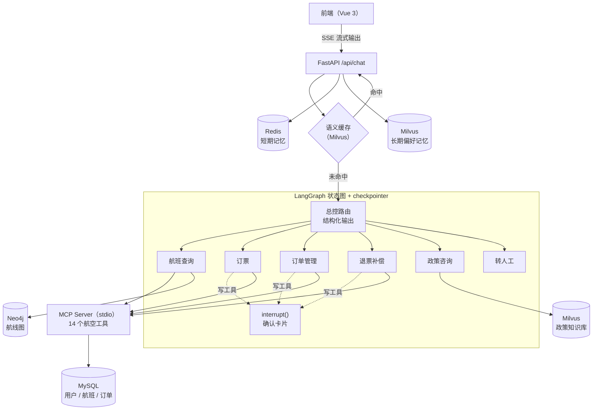

# 翼枢 WingDesk — 航空公司多 Agent 智能客服

[English](README.md) | **简体中文**

翼枢 WingDesk 是一个航空公司的多 Agent 智能客服系统。用户可以用自然语言查航班、订票、改签、退票、咨询行李和退款政策、申请补偿。

航空客服的难点不在于"会聊天"，而在于**真的能办事**：每一步都受很细的政策约束，而且**不能办错**。本项目的设计原则是：

> **能用代码保证的，不交给模型。**

- 写操作必须经用户确认 → 用 LangGraph `interrupt` 实现，而不是写在提示词里
- 路由结果必须合法 → 结构化输出 + 枚举，而不是解析字符串
- 用户不能越权访问别人的数据 → `user_id` 由代码注入，不信任模型传入的值
- 关键业务规则不能被突破 → 在执行写操作前用代码校验，而不是只写在提示词里

<!-- 演示 GIF：录制后保存为 docs/demo.gif，再取消下一行的注释。

-->

## 架构



| 层 | 技术 | 作用 |
|---|---|---|
| Agent | LangGraph、LangChain | 总控路由 + 5 个专业 ReAct Agent + 转人工；checkpointer 负责多轮状态和暂停 / 恢复 |
| 工具 | MCP（FastMCP、`langchain-mcp-adapters`） | 14 个航空工具封装成独立服务；全应用共享一个长连接会话 |
| 业务数据 | MySQL 8 | 10 张表；写操作全部走事务 + 行锁（`SELECT … FOR UPDATE`） |
| 航线图 | Neo4j | 机场和航班建成图；参数化 Cypher 查 1–3 段航线 |
| 向量库 | Milvus 2.5 | 政策 RAG、语义缓存、用户长期偏好 |
| 短期记忆 | Redis | 最近几轮对话存成 List，原子写入 |
| 大模型 | 通义千问 `qwen-plus`、`text-embedding-v2` | 走 OpenAI 兼容接口，换模型只改配置 |
| 接口 / 前端 | FastAPI、SSE、Vue 3 + TypeScript + Vite | 真流式输出、实时显示路由轨迹、确认卡片；模型输出渲染前用 DOMPurify 消毒 |

### Agent 分工与最小权限

| Agent | 职责 | 工具 |
|---|---|---|
| 总控路由 | 识别意图并路由（粘性路由：进行中的任务继续交给当前 Agent） | 无 |
| 航班查询 | 机场、直飞和中转航班、航线 | 只读 |
| 订票 | 订新票 | 查询、用户信息、`calculate`、`book_reservation` |
| 订单管理 | 查订单；改航班、舱位、行李、乘客 | 只读 + `update_reservation_*` |
| 退票补偿 | 退票、补偿 | 只读 + `cancel_reservation`、`send_certificate` |
| 政策咨询 | 用 RAG 回答政策问题 | Milvus 检索 |
| 转人工 | 转接人工客服 | `transfer_to_human_agents` |

每个专业 Agent 只拿到自己需要的工具和政策条款。只读 Agent 根本拿不到写工具。

## 关键设计

### 1. 用 `interrupt` 实现写操作的人工确认

只靠提示词（"订票前先问用户"）是概率性的约束。测试中就出现过模型不调用工具、在对话里反复确认的情况。所以每个写工具外面都包了一层：执行前调用 LangGraph 的 `interrupt()`，整张图挂起，状态存进 checkpointer；前端弹出确认卡片，用户确认后用 `Command(resume=...)` 恢复执行。

- 卡片上的摘要**由代码根据真实的工具参数生成**，不是模型写的，保证用户确认的就是真正要执行的操作。
- 用户不点按钮、直接打字回复时，视为修改意见：Agent 调整方案后重新弹出卡片。
- `thread_id = user_id:session_id`。只用 `session_id` 时，不同用户会共享默认会话。

### 2. MCP：全局长连接，而不是每次调用拉起一个子进程

每次工具调用都要 300 多毫秒，而数据库查询本身只要几毫秒。读了 `langchain-mcp-adapters` 的源码发现：`client.get_tools()` 加载的工具是无状态的，**每次调用都会新建会话，对 stdio 传输来说就是拉起一个新的子进程**，再重新握手。WingDesk 在 FastAPI 的 `lifespan` 里开一个会话，全应用共享。

| | 平均 | 中位数 | P95 |
|---|---|---|---|
| 每次调用新建会话 | 342.0 ms | 320.4 ms | 502.6 ms |
| 全局长连接 | 3.9 ms | 3.5 ms | 9.4 ms |

<sub>`search_direct_flight` 调用 20 次，脚本 `agent/tests/bench_mcp_session.py`。</sub>

### 3. 用实验确定阈值的语义缓存

高频政策问题直接走缓存，省掉一次完整的 Agent 调用。开发中发现一个容易踩的坑：Milvus 的 COSINE 返回的是**相似度**而不是**距离**，按距离来比较（`<=`）会导致语义匹配永远不命中，应为 `>=`。修正以后，阈值用实验来定，而不是凭感觉：

- 测试集 57 句：30 句同义问法、17 句难负例（字面很像，但答案不同，例如"我的退款为什么还没到账"）、10 句简单负例。
- 对比三个 embedding 模型（`text-embedding-v2/v3/v4`）：不同模型的相似度刻度不同，阈值不能照搬。
- 两个改进：每个答案存多种问法；加规则前置过滤，个人问题（"我的订单"、订单号等）直接交给 Agent。

| 配置（`text-embedding-v2`） | 零误命中时的召回率 |
|---|---|
| 只靠阈值 | 33% |
| + 多问法 + 规则前置过滤 | **90%**（阈值 0.66） |

缓存命中时，这一轮问答也会补写进 checkpointer，下一轮 Agent 仍然知道用户刚问过什么。

### 更多工程细节

- **业务规则下沉到代码。** 付款限制（例如每个订单最多用一张代金券）和免费托运行李额度，在写工具执行前用代码校验。测试中模型在用户坚持时会违反这些规则，所以不再只依赖提示词。
- **三层防越权。** 模型看到的工具参数里删掉了 `user_id`；拦截器从会话里注入 `user_id`，拿不到就拒绝（fail-closed）；MCP Server 校验订单归属，越权时返回和"订单不存在"相同的错误，防止被探测。
- **短期记忆原子写入。** 如果对 JSON 字符串"读 → 改 → 写"，200 个并发写入会丢 98% 的消息（`agent/scripts/bench_redis_race.py`）。现在用 Redis List 的 `MULTI` + `RPUSH` + `LTRIM` + `EXPIRE`，丢失为 0。
- **真流式输出。** `graph.astream(stream_mode=["updates", "messages"], subgraphs=True)` 通过 SSE 实时推送节点切换、工具调用和 token。首字延迟中位数从 7068 ms 降到 3878 ms（-45%）。图在后台任务里运行，浏览器中途关闭也会把这一轮跑完，checkpointer 里不会留下半截状态。
- **同一会话一次只处理一个请求。** 按 `user_id:session_id` 加 `asyncio.Lock`：一轮还没跑完时，同一会话的新请求直接被拒，重复提交不会把同一个写操作执行两次。锁交给后台任务持有，这一轮真正结束才释放，浏览器断开也不会提前释放。这是进程内的锁，多实例部署时要换成分布式锁（如 Redis `SET NX PX`）。
- **固定数据集上的实时演示。** 数据集是 2024-05-15 15:00 的快照。统一的时钟模块（`core/clock.py`）提供两种模式：`fixed` 给测试和评测用，保证结果可复现；`live` 给演示用。演示时由 `demo_data.py` 把所有日期整体平移同样的天数，让快照对齐到今天（"3 天前下单""5 天后起飞"这类相对关系不变），把今天的航班状态对齐到当前时刻，并用确定性随机种子滚动生成往后 60 天的航班。航班到了起飞当天停止售票，变成准点、延误或取消，再随时间变成飞行中、已降落。
- **可靠的路由。** 总控用 `with_structured_output` + `Literal` 枚举；解析失败有兜底；用户没有要求人工时，代码会拦下转人工的路由。

## 快速开始

### 环境要求

- Python 3.11、Node.js 20.19+ 或 22.12+、Docker
- 阿里云百炼（DashScope）API Key

### 1. 启动基础服务

```bash
docker run -d --name redis  -p 6379:6379 redis:7
docker run -d --name mysql8 -p 3306:3306 -e MYSQL_ROOT_PASSWORD=<mysql密码> mysql:8.0
docker run -d --name neo4j  -p 7474:7474 -p 7687:7687 -e NEO4J_AUTH=neo4j/<neo4j密码> neo4j:5

# Milvus 单机版（内置 etcd + 本地存储），可视化管理界面 Attu 在 :8000
mkdir -p ~/milvus-deploy/volumes/milvus
docker compose -f deploy/milvus/docker-compose.yml up -d
```

### 2. Python 环境与配置

```bash
conda create -n wingdesk python=3.11 -y && conda activate wingdesk
pip install -r requirements.txt

cp agent/.env.example agent/.env
# 填写 DASHSCOPE_API_KEY、MYSQL_PASSWORD、NEO4J_PASSWORD
```

### 3. 导入数据（在仓库根目录执行）

```bash
python agent/database/import_airline.py           # MySQL：airline 库，10 张表
python agent/database/check_airline_roundtrip.py  # 校验 MySQL 数据能逐字还原成原始 JSON
python agent/database/import_airline_graph.py     # Neo4j：20 个机场、300 个航班
python agent/database/import_airline_policy.py    # Milvus：政策文档切分、向量化、入库
python app/preload_cache.py                       # Milvus：预热语义缓存
python agent/database/demo_data.py rebase         # 把演示数据平移到今天，并生成往后 60 天的航班
```

`agent/.env` 里设置了 `WINGDESK_CLOCK=live`，系统按真实的当前时间（美国东部时间）运行。后端运行期间每小时自动往后滚动生成航班。想要一份干净的演示数据时，重新执行一次 `rebase` 即可。

### 4. 运行

```bash
# 后端：必须在仓库根目录启动（MCP Server 的配置用的是相对路径）
uvicorn app_main:app --app-dir app --host 0.0.0.0 --port 5000

# 前端
cd front/web && npm install && npm run dev        # http://localhost:5173
```

前端默认请求 `http://127.0.0.1:5000/api/chat`，可以用环境变量 `VITE_API_URL` 修改。也可以在终端里直接对话：`python agent/main.py`。

### 试一试

在顶部选择演示账号：`mia_li_3668`（金卡会员）或 `lucas_wilson_8118`（银卡会员）。日期以当前的美国东部时间为准。可以试试：

- 帮我查后天纽约到西雅图的航班
- 金卡会员坐经济舱可以免费托运几件行李？
- 帮我取消订单 …（能看到政策校验和确认卡片）
- 查一下用户 lucas_wilson_8118 的订单（访问别人的数据，会被拦截）

## 测试与评测

```bash
pytest agent/tests -q
```

- 工具测试把每个 MySQL 后端工具和参考实现逐字比对（全部 500 个用户、2000 个订单、所有直飞和中转查询组合）。使用独立的 `airline_test` 库，需要本机 MySQL。
- 状态图和服务层测试用脚本化的假模型，不调用 API。
- `agent/scripts/` 里是上面各项数据对应的基准脚本（缓存阈值、Redis 并发、流式延迟）。
- `eval/` 是多轮对话回归测试：由大模型扮演顾客，按对话结束时的数据库状态判定对错，写操作的参数错一个就算失败。详见 [eval/README.md](eval/README.md)。

## 目录结构

```
├── app/                    FastAPI：SSE 对话接口、语义缓存、缓存预热
├── agent/
│   ├── agents/             总控、专业 Agent、人工确认包装、提示词
│   ├── core/workflow/      状态图、状态定义、runner（流式、interrupt / resume）
│   ├── core/memory/        Redis 短期记忆、Milvus 长期记忆、偏好抽取
│   ├── core/mcp/           MCP 长连接管理、user_id 拦截器
│   ├── core/policy_rules.py  写操作前的业务规则校验
│   ├── backends/           AirlineBackend 接口：MySQL 后端 / 评测后端
│   ├── mcp_servers/        航空 MCP Server（14 个工具）
│   ├── tools/              政策检索（Milvus）、航线图（Neo4j）
│   ├── database/           表结构与导入脚本
│   ├── scripts/            基准测试与端到端演示脚本
│   └── tests/              pytest
├── data/airline/           航空数据、中文政策文档、缓存问答
├── eval/                   多轮对话评测与结果
├── front/web/              Vue 3 + TypeScript 前端
└── deploy/milvus/          Milvus docker-compose
```

## 不足与后续计划

- checkpointer 目前是 `MemorySaver`（存在进程内存里）：后端重启后，进行中的对话和待确认操作会丢失。下一步换成 Redis 或 Postgres checkpointer。
- 政策检索只用了向量检索，对"随身行李"和"托运行李"这类相近主题区分不好。下一步做混合检索（BM25 + 向量）和重排，并扩充检索测试集。
- MCP 子进程意外退出时，还不能自动重连。

## 数据来源与致谢

- 用户、航班、订单数据和核心航空政策来自 Sierra 的 [τ-bench](https://github.com/sierra-research/tau-bench) airline 领域（MIT 协议，见 `data/airline/LICENSE-tau-bench`）。测试中用作参考实现的工具代码在 `third_party/tau_bench_airline/`，附带原协议。
- 7 篇核心中文政策是原版政策的逐条翻译。`data/airline/policy/extended/` 下的 18 篇是为演示 RAG **仿真生成**的政策，不是任何真实航空公司的规定。
- 演示库里的日期是平移到当前时间的；原始 30 天以外的航班（余座、价格，以及起飞当天的延误和取消）是由 `agent/database/demo_data.py` **仿真生成**的。测试和评测使用原始快照。
